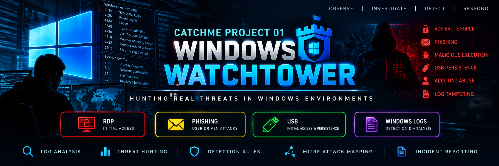

# CatchMe Project 01 — Windows Watchtower
## Windows Security Monitoring & Threat Detection

**Project status:** In progress — evidence-led case studies documented; full EVTX exports, complete correlation, and Elastic detection validation remain pending.

Windows Watchtower is a Windows log-analysis and initial-access investigation portfolio project. It brings together the supplied Event Viewer/Sysmon screenshots, PowerShell history notes, and the two uploaded Markdown reference notes. The source material contains several separate training cases. **They are documented as independent case tracks, not as one continuous incident.**

## What this package covers

1. **THM-PC Security/Sysmon review:** reported failed logons, a successful RDP session, a newly created account and group changes, suspicious executable and Startup-folder artifact, DNS/network activity, and PowerShell history.
2. **RDP Initial Access case:** repeated failed logons followed by a successful remote-interactive logon; source IP and remote workstation are captured from the supplied screenshots/notes.
3. **Phishing Initial Access cases:** misleading-extension executable (`www.skype.com`) and a separate LNK/`best-cat.jpg.exe` case.
4. **USB Initial Access case:** executable launched from removable media, a dropped executable, a Run-key value, and a second USB copy.
5. **Windows logging fundamentals, detection hypotheses, query planning, MITRE ATT&CK mapping, evidence index, and response recommendations.**

## Important evidence boundary

- Findings are based on screenshots and user-provided notes. Original EVTX files and the actual suspicious binaries/shortcuts were not supplied for independent parsing.
- Event timestamps shown in screenshots come from separate scenarios and dates. Do not merge them into a single timeline.
- The reported indicators are not independently checked for current reputation or live infrastructure status.
- A screenshot of a registry value or Startup artifact supports the presence of the recorded value/path, but not necessarily successful persistence or execution.
- Elastic Agent/integration ingestion and executable KQL rules have **not** been verified. Query notes are investigation plans, not tested production detections.

## Repository map

- `docs/` — scope/status, logging fundamentals, case notes, and PowerShell review.
- `cases/rdp-initial-access/` — RDP case findings and analyst workflow.
- `cases/phishing-binary/` — misleading-extension binary case.
- `cases/phishing-lnk/` — LNK and double-extension payload case.
- `cases/usb-initial-access/` — removable-media case.
- `queries/` — query plan and generic investigation patterns.
- `detections/` — detection hypotheses and validation criteria.
- `reports/` — initial findings and incident response report.
- `evidence/evidence-register.md` — evidence inventory and limitations.
- `evidence/screenshots/` — supplied screenshots, copied without modifying their contents.
- `reference-notes/` — original Markdown notes supplied for this project.

## Recommended analyst workflow

1. Preserve original `.evtx` files and record host, timezone, collection time, and SHA-256 hashes.
2. Verify each case's host, time window, account, source IP, and event XML before finalizing conclusions.
3. Correlate Security `4625`/`4624` and account-management events; use Logon ID where applicable.
4. Correlate Sysmon process/file/registry/network/DNS events using Process GUID/PID, parent process, timestamps, and user context.
5. Review PSReadLine history as a lead only; compare with PowerShell Operational logs and available Script Block/Module/Transcript logging.
6. Confirm Elastic data sources and actual field mappings before implementing KQL.
7. Validate detections only with safe, controlled activity in an authorized lab.

## Safety and public-release hygiene

Do not execute suspicious binaries, open suspicious shortcuts, or browse to the recorded URLs. Review artifacts as inert data in an isolated, authorized lab. Before public release, redact any credentials, personal data, internal addresses, or sensitive host identifiers that are not necessary for the learning objective.
