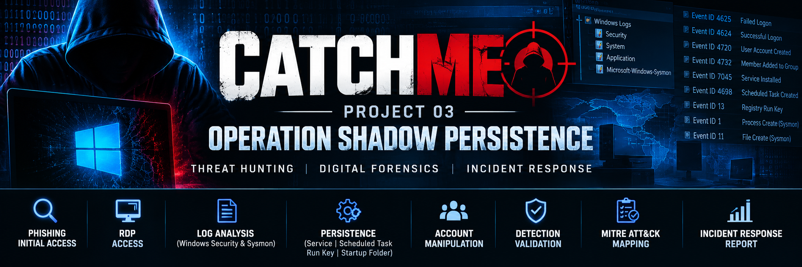

# CatchMe Project 03 — Operation Shadow Persistence

**Project type:** Windows SOC investigation and threat hunting  
**Status:** Investigation findings documented; final publication review remains open  
**Analysis workstation:** Kali Linux  
**Evidence source:** Supplied Windows Security and Sysmon EVTX files, a suspicious ZIP/LNK pair, and lab notes/screenshots

## Objective

Investigate Windows persistence and account-management activity, correlate Windows Security and Sysmon telemetry, build a UTC timeline, identify detection opportunities, and document response recommendations.

## Key findings

The analyzed event exports contain evidence of:
- Security audit-log clearing (Security Event ID 1102).
- Installation of a service named `Data Protection Service`, configured for automatic start and pointing to `C:\Windows\Help\nessie.exe` (Security Event ID 4697).
- Registration of a scheduled task named `AmazonSync` with a boot trigger and an action pointing to `C:\Program Files\Common Files\troy.exe` (Security Event ID 4698).
- A PowerShell command downloading and launching `update.exe`, followed by a Sysmon file-creation event.
- Six failed Administrator network logons followed by successful logons from the same source address, then a remote-interactive Administrator session.
- Creation and enablement of a `support` account, a password-reset event, and addition of the account to the built-in Users and Administrators groups.
- A Run-key value named `Basket` pointing to `C:\Users\Public\kitten.exe`, followed by process execution in a separate after-reboot log.
- DNS query attempts associated with suspicious executables. The reviewed DNS events report status `9003` with no results; successful resolution or command-and-control is not established by those records.

The detailed findings and limitations are in `cases/Persistence-Findings.md` and `reports/Incident-Response-Report.md`.

## Evidence handling

Six original EVTX files were parsed with `python-evtx` in an isolated Python environment. The six exports yielded 256 parsed records and no parser errors. Successful parsing does not prove that the source logs are complete, authentic, or representative of all activity.

The original evidence files remain outside this public review package. SHA-256 hashes were recorded in the local evidence manifest. The additional file `Sysmon (After Reboot) (copy 1).evtx` has a different SHA-256 from `Sysmon (After Reboot).evtx`; both should be preserved until their provenance is resolved.

## Repository contents

- `cases/` — consolidated case notes and persistence findings
- `docs/` — timeline, lab architecture, detection validation plan, and candidate ATT&CK mapping
- `evidence/Evidence-Register.csv` — evidence inventory with original-evidence hashes
- `reports/` — executive summary and incident-response report
- `assets/screenshots/README.md` — screenshot publication status

Screenshots are intentionally excluded from this review build until their contents have been checked for sensitive lab details.

## Limitations

- The events establish recorded activity, not the identity or intent of a human operator.
- DNS query attempts with status `9003` do not establish successful C2.
- Distinct EVTX exports and reboot captures are kept separate unless event content supports correlation.
- ATT&CK mappings are candidates and should be checked against current official technique descriptions before publication.
- The suspicious ZIP/LNK artifacts and raw EVTX files are not included in this package.

## Learning outcomes

The investigation demonstrates how to correlate Windows Security and Sysmon telemetry across account activity, service installation, scheduled tasks, registry Run keys, process execution, and DNS queries. It also emphasizes evidence preservation, careful timeline construction, and distinguishing confirmed event observations from hypotheses.
