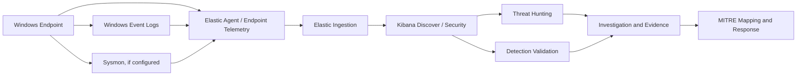

# CatchMe Windows SOC
## Enterprise Windows Security Monitoring, Threat Hunting & Incident Response

> CatchMe Security Operations · Evidence-driven Windows endpoint investigations


CatchMe Windows SOC is a hands-on lab for investigating Windows endpoint activity through security telemetry, threat hunting, detection engineering, digital forensics, and incident response. Each investigation follows an evidence-first process: establish a baseline, execute an authorized test, validate telemetry, hunt and correlate events, assess detections, map supported behavior to MITRE ATT&CK, and document response and cleanup.

**Important:** Planned scenarios, illustrative diagrams, baseline checks, observed events, and confirmed alerts are different evidence states. Never report an attack or alert as confirmed without supporting records.

## Objectives

- Verify Windows version, architecture, hostname, resources, networking, and security posture before testing.
- Check existing Windows Event Logs, PowerShell logging, Sysmon, Elastic Agent, and Elastic Defend coverage.
- Avoid duplicate agents and unnecessary telemetry sources.
- Investigate process execution, PowerShell, authentication, account changes, persistence, files, and network activity.
- Validate KQL against the actual Elastic fields and data streams.
- Record whether activity was observed, detected, alerted on, or not found.
- Preserve evidence, verify cleanup, and keep the endpoint secure.

## Scope and Investigation Areas

| Area | Example evidence |
|---|---|
| Process execution | Sysmon Event ID 1; Security 4688 if process auditing is enabled; Elastic endpoint events |
| PowerShell | Microsoft-Windows-PowerShell/Operational; relevant process telemetry |
| Authentication | Security events such as 4624, 4625, 4648, where generated |
| Accounts and privileges | Security events and account/group state |
| Persistence | Task Scheduler, services, registry autoruns, startup locations |
| File activity | Sysmon file events if configured; endpoint file telemetry |
| Network activity | Sysmon network events if configured; endpoint/network sensor data |
| Incident response | Correlated event documents, host evidence, timeline and response records |

Coverage depends on Windows version, audit policy, Sysmon configuration, Elastic integration, and agent policy. These sources must be verified; this table does not guarantee they are currently collected.

## Lab Architecture

The existing SOC lab has used Elastic at `192.168.1.11`. Treat this as a reference address until connectivity and service ports are verified from the Windows endpoint.

| Component | Status |
|---|---|
| Windows hostname/IP/OS/build | Record during preflight |
| Elastic/Kibana (`192.168.1.11`) | Connectivity pending verification |
| Fleet URL/port and agent enrollment | Verify actual configuration |
| Elastic Agent / Elastic Defend | Inspect installed state and health |
| Sysmon | Inspect service and configuration before installing |
| Windows event channels | Verify enabled state and records |
| Timezone and clock sync | Record for timeline correlation |

### Planned data flow



This is a planned architecture, not proof that each source is installed or ingesting data.

## Environment Readiness Checklist

| Check | Status |
|---|---|
| Windows edition, version, build, architecture | Pending |
| CPU, RAM, disk space | Pending |
| Hostname, IP, gateway, DNS, network profile | Pending |
| Elastic/Kibana connectivity | Pending |
| Fleet connectivity, agent enrollment and health | Pending |
| Sysmon status/configuration | Pending |
| Required Windows event channels and records | Pending |
| Defender and Windows Firewall state | Pending |
| Timezone and clock synchronization | Pending |
| Baseline telemetry captured | Pending |

Do not execute attack scenarios until the readiness output is reviewed. Keep Defender, Windows Firewall, and logging enabled unless a narrowly scoped, authorized test requires a documented change.

## Project Workflow

| Phase | Activity | Completion requirement |
|---|---|---|
| 00 | README and scope | Objectives, scope and structure reviewed |
| 01 | Environment verification | Host, network and telemetry state recorded |
| 02 | Baseline validation | Baseline security posture and events recorded |
| 03 | Pre-attack planning | Hypothesis, control matrix and telemetry needs defined |
| 04 | Controlled attack execution | Test steps and actual outcomes recorded |
| 05 | Telemetry validation | Relevant events and fields checked |
| 06 | Threat hunting | Queries executed; findings evidence-backed |
| 07 | Detection validation | Rule behavior and actual alert status recorded |
| 08 | Investigation | Process relationships, timeline and findings correlated |
| 09 | MITRE ATT&CK | Mapping justified by observed behavior |
| 10 | Incident response and cleanup | Actions and cleanup verified |
| 11 | Evidence finalization | Screenshots sanitized and hashes checked |
| 12 | Quality review/publication | Links, structure, queries, diagrams and claims reviewed |

## Proposed Windows Project Sequence

1. **Windows Process Execution & Process-Tree Investigation**
2. **PowerShell Activity Investigation**
3. **Authentication & Account Anomaly Investigation**
4. **Windows Persistence Investigation**
5. **Windows Threat Hunting & Detection Engineering**
6. **Multi-Stage Windows Incident Investigation**

This is a proposed sequence. Confirm it against the wider CatchMe SOC roadmap before execution.

## Repository Structure

Use this layout for each individual Windows project, inspecting existing files before creating or replacing anything.

```text
XX-Windows-Project-Name/
├── README.md
├── 00-pre-attack/
├── 01-attack/
├── 02-telemetry/
├── 03-threat-hunting/
├── 04-detection/
│   ├── sigma/
│   └── yara/
├── 05-investigation/
├── 06-mitre/
├── 07-incident-response/
├── 08-diagrams/
│   └── mermaid/
├── 09-Screenshots/
│   ├── Attack/
│   ├── Telemetry/
│   ├── Hunting/
│   ├── Detection/
│   ├── Investigation/
│   ├── Mitre/
│   └── Incident-Response/
├── 10-Queries/
│   ├── KQL/
│   └── supporting-queries/
├── 11-Evidence/
│   ├── Raw/
│   ├── Sanitized/
│   └── Hashes/
└── 12-Assets/
```

YARA is for matching patterns in files or memory, not a generic process-behavior detector. Include YARA only when the scenario justifies it.

## Evidence and Timestamp Standards

- Record timestamps with timezone and preserve original event timestamps.
- Use consistent IDs, e.g. `W01-ATT-01`, `W01-TEL-01`, `W01-HUNT-01`, `W01-DET-01`, `W01-INV-01`, `W01-IR-01`.
- Keep raw evidence local where necessary; put publication-safe material in `11-Evidence/Sanitized/`.
- Store SHA-256 manifests in `11-Evidence/Hashes/` and verify hashes.
- Redact credentials, tokens, personal data, and sensitive internal information before publication.
- Record the exact query, time range, data view/index, host identifier, and event/alert IDs.
- Never invent timestamps, alert IDs, screenshots, event fields, attack results, or remediation outcomes.

## Detection and Validation Standards

For every detection candidate, document its objective, required source events and fields, query/rule logic, expected matches, false positives, test procedure, observed result, alert status, and limitations. A rule file existing does not mean it parsed, was deployed, matched, or generated an alert.

## Safety and Scope

- Test only systems you own or are authorized to assess.
- Prefer snapshots or disposable VMs for scenarios requiring vulnerable configurations.
- Do not disable security controls or logging just to make a test work.
- Avoid destructive behavior, uncontrolled outbound activity, or unapproved persistence.
- Capture evidence before cleanup; verify cleanup afterward.
- Clearly label simulated activity and illustrative diagrams.

## Completion Criteria

- [ ] Windows host and network details verified.
- [ ] Elastic/Fleet connectivity and agent status recorded.
- [ ] Required event channels and fields validated.
- [ ] Baseline captured before testing.
- [ ] Test steps and outcomes accurately documented.
- [ ] KQL queries tested against actual telemetry.
- [ ] Detection logic validated or marked as a candidate.
- [ ] Alert status supported by an actual alert record.
- [ ] Investigation timeline and conclusions evidence-backed.
- [ ] MITRE ATT&CK mappings justified.
- [ ] Response and cleanup verified.
- [ ] Screenshots sanitized and evidence hashes checked.
- [ ] Repository and publication claims reviewed.

## Current Status

**Planning / readiness verification pending.** This README defines the scope and workflow only. It does not claim that the Windows endpoint has passed readiness checks, that telemetry is currently ingesting, or that any attack or detection has been completed. Update it only after reviewing actual environment output and evidence.
